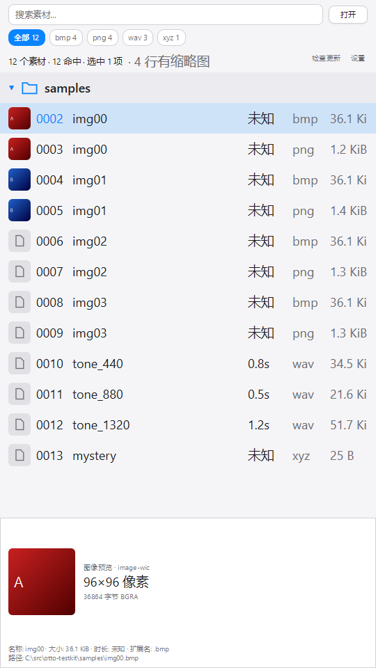

# OTTO Sample Manager

一个用 **纯 Zig + Windows 原生 API** 编写的桌面媒体素材管理器。

适用于音乐制作、鬼畜 / 人力调音、声音设计、视频剪辑、播客、游戏音频与多媒体后期等需要频繁查找、试听和复用素材的工作流程。支持音频、图片和视频素材，也可拖入 Melodyne、Vegas、FL Studio 等宿主使用。

OTTO 负责把常用素材**导入、搜索、预览、整理并复用**；素材库只保存路径、索引和用户整理结果，**不复制或接管原始媒体文件**。

当前版本：**0.63.0**
下载：[GitHub Releases](https://github.com/TLBtianhu/OTTO-sample-manager/releases/latest)

作者：
B 站 [@TLB天狐](https://space.bilibili.com/446725356)
B 站 [@杨薇柏_Official](https://space.bilibili.com/1042301441/)
B 站 [@_Candace_](https://space.bilibili.com/364700163)

---

## 当前界面



默认窗口为 **540×960**；最小窗口为 **384×768**。窗口缩到下限时，预览仍保留完整布局，不会退化成一条无法使用的细条。

---

## 主要功能

### 导入与整理

- 点击「打开」可同时选择**多个文件**或**一个文件夹**。
- 也可以直接从资源管理器把文件或文件夹**拖进 OTTO**。
- 多文件作为平铺素材导入；文件夹保留目录节点和层级。
- 支持目录树、搜索、类型筛选、多选与批量操作。
- 素材以文件身份跟踪，重扫、排序或分页后不会把操作错落到其他行。

### 预览与复用

- 音频试听、暂停、seek 与波形预览。
- WAV / AIFF / FLAC / MP3 / Ogg Vorbis / Opus 由自带的 **zig-audio** 解码。
- 图片及系统支持的媒体格式按 provider 能力预览。
- 支持拖出到宿主，以及浏览模式下的 Shell「打开方式」。
- 波形、缩略图与 PCM 均有明确的内存预算和生命周期，不靠无限缓存换速度。

### 从库中移除

选中素材或文件夹后，点击「从库中移除」或按 Delete：

- **只从 OTTO 的显示和素材库记录中移除**。
- **不删除、不移动、不改名磁盘上的源文件**。
- 文件夹会连同其中的素材一起移除。
- 排除记录持久保存，重启、重扫和文件监听都不会让项目复活。
- 显式重新导入表示恢复意图，会清除对应排除记录并重新入库。
- 正在预览或播放的项目被移除时，会安全停止并清理状态。

### 只读目录浏览

浏览模式用于直接查看磁盘目录，导航、多选、滚动位置和「打开方式」都可使用，但：

- 不写源目录。
- 不写素材库。
- 不写设置。
- 不提供「从库中移除」。

预览、播放、Shell 打开和交给宿主是不同操作，不会互相冒充。

---

## 安装、数据与升级

### 安装版

默认安装根：

```text
%LOCALAPPDATA%\Programs\OTTO\
  Uninstall.exe  唯一卸载器（开始菜单与注册表指向这里）
  app\    otto-lite.exe / otto-thumb-host.exe / README.txt / LICENSE
  data\   settings.json / library.otto
  cache\  缩略图等可再生缓存
```

- 默认当前用户安装，**不需要管理员权限**；安装页可以更改根目录。
- 安装器只写 `app\` 与根目录唯一卸载器，不创建或覆盖 `data\`、`cache\`。
- 覆盖升级会替换 `app\` 并清除旧版 `app\Uninstall.exe`，**素材库、设置和缓存逐字节保留**。
- 卸载默认只移除主程序与卸载入口；配置、素材库和缓存只有明确勾选才删除。
- 静默卸载 `<根>\Uninstall.exe /S` 始终只删除程序侧，保留全部用户数据。
- 安装版可手动检查更新；下载的安装包必须验证 minisign 签名后才会运行。

### 便携版

- 解压即可运行，数据在 `<exe>\data`。
- 不依赖系统注册，也不会自动覆盖运行中的程序。

### 开发版

当 exe 位于 `<项目>\zig-out\bin\otto-lite.exe` 时：

- 设置、缓存、更新下载和 `crash.log` 都写入 `<项目>\.otto-dev`。
- 不写 `%LOCALAPPDATA%\OTTO\dev`，也不回退到 `%TEMP%\OTTO-dev`。
- `.otto-dev` 已被 Git 忽略，`zig-out` 本身不承载运行数据。

---

## 技术栈

- **Zig 0.17**，无 C 源码、无实际 `@cImport`。
- 默认目标为 **x86_64_v2**，避免发布包继承构建机器的 AVX512 指令。
- 原生 Win32 / DirectWrite / WIC / Media Foundation / WASAPI。
- UI 使用 [nanoui](https://github.com/TLBtianhu/nanoui) 的 Windows 分支。
- 音频解码使用自带的 [zig-audio](https://github.com/TLBtianhu/zig-audio)。
- 安装包使用 NSIS，发布物附带 minisign 签名。

历史 Tauri / Electron 实现保留在其他分支；它们不是当前发布入口。首页只描述当前 Zig 主线已经实现并验收的能力。

---

## 构建与测试

### 环境

- Windows 10/11 x64
- Zig 0.17
- PowerShell 7
- 打包时另需 Node.js 与 NSIS

### 构建

```powershell
cd zig\app
zig build -Drelease=true
```

### 测试

```powershell
cd zig\core   ; zig build test   # 94 项：数据层
cd zig\ports  ; zig build test   # 192 项：Win32 接口
cd zig\app    ; zig build test   # 416 项：应用层
```

### 发布前验收

```powershell
zig\health.ps1 -Quick     # 构建 / 测试 / 三形态 / provider / 透明度 / 签名
zig\membudget.ps1         # 可见工作集、缓存与 PCM 预算
zig\browse.ps1            # 浏览模式 49 项验收
zig\remove_accept.ps1     # 真实隐藏窗口：移除、重启不复活、显式重导入恢复
zig\fresh-user.ps1        # 安装 → 覆盖升级 → 卸载与数据保留
```

### 打包

```powershell
zig\package.ps1 -Version 0.63.0
```

产物在 `zig\dist`：便携 zip、安装 exe 及各自的 `.sig`。

---

## 开发文档

- [`zig/app/README.md`](zig/app/README.md)：应用层能力与验收口径
- [`zig/core/README.md`](zig/core/README.md)：素材库数据层
- [`zig/CHARTER.md`](zig/CHARTER.md)：内存、只读浏览、命名等约束
- [`zig/PERF.md`](zig/PERF.md) / [`zig/MEMORY.md`](zig/MEMORY.md)：性能与内存记录
- [`zig/CHANGELOG.md`](zig/CHANGELOG.md)：逐版本变更
