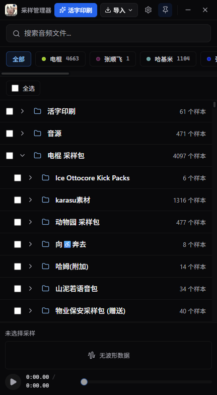
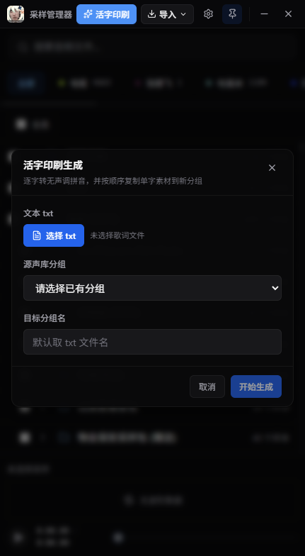
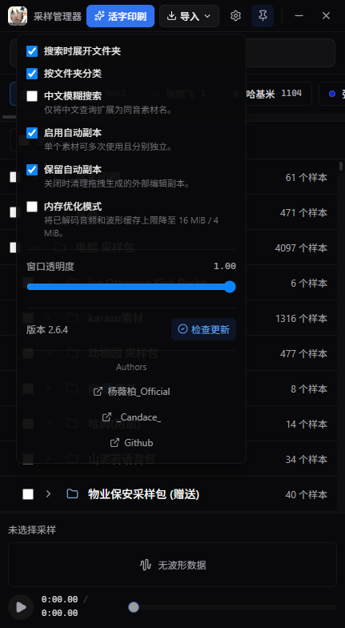
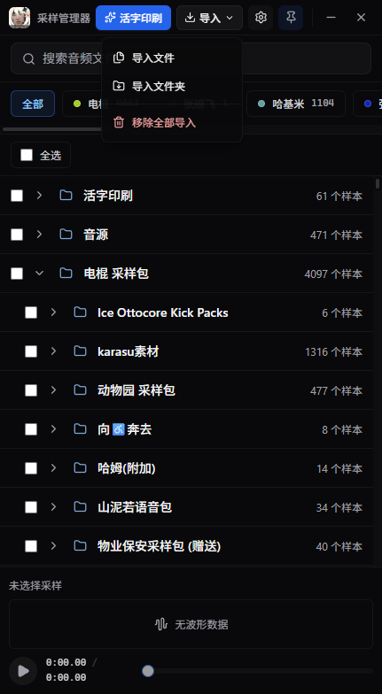

# OTTO Sample Manager

一个面向鬼畜 / 人力调音工作流的桌面音频素材管理器。  
适用于 Melodyne（主）、Vegas、FL Studio 等场景，把常用素材的**导入、预览、整理、拖拽复用、预解码**，节省加载时间，并且有**♿️一键活字印刷♿️**功能，极大提升人力鬼畜的效率。

作者：  
b站 @杨薇柏_Official（https://space.bilibili.com/1042301441/）  
b站 @_Candace_(https://space.bilibili.com/364700163)

---

## 软件截图

| 主界面 | 活字印刷 |
| :---: | :---: |
|  |  |
| 素材分组、目录树、搜索与底部播放器 | 从歌词文本生成有序单字素材 |

| 设置 | 导入 |
| :---: | :---: |
|  |  |
| 搜索、文件夹、副本、内存与更新设置 | 导入文件、文件夹或移除全部导入 |

---

## 项目特色

制冰时对素材处理的常见问题：

- 素材散落在多个文件夹里，整理困难
- 导入后试听、比对和筛选效率低
- 频繁拖入 DAW / 调音软件时，工作流中断
- 重复使用素材时容易弄乱原始文件
- 一旦素材量变大，界面和响应速度很容易变差
- 用melodyne拼字时，找素材是最大的工程量之一

OTTO Sample Manager：

- 保留原有素材目录结构
- 快速导入和批量管理采样
- 统一试听与波形预览
- 面向实际制作流程优化拖拽与复用体验
- 尽量减少重复解码、重复 IO 和无意义缓存
- （♿️重点♿️）**一键活字印刷，省去找素材的时间**

---

## 项目定位

核心优先级是：

1. **性能**：导入快、解码快、列表响应快  
2. **工作流**：方便试听、分组、拖拽、重复使用  
3. **界面**：保持简洁，轻量资源管理器  

---

## 主要功能

### 1. 目录树导入
- 支持按目录导入音频素材
- 保留根目录结构
- 支持多个根目录叠加管理

---

### 2. 音频预览与波形显示
- 支持播放 / 暂停
- 底部播放器显示进度
- 支持拖动进度条 seek
- 内置波形缓存用于快速预览

---

### 3. 拖拽到调音软件
- 支持拖入 Melodyne 3、FL Studio 等软件
- 优化“试听 → 拖出”的连续操作体验

---

### 4. 自动副本机制（主要特点）
防止外部软件污染原素材（尤其是 Melodyne 对复用素材会一起操作）：

- 第一次拖出：使用原文件
- 第二次开始：生成副本
- 打包版副本存储在 **用户数据目录 / Copy**（Windows 默认为 `%APPDATA%/sample-manager/Copy`）
- 副本不在 UI 显示

---

### 5. 活字印刷生成（歌词自动组装 🔥）

核心新功能：**从歌词自动生成可用素材序列**

工作流：

```
歌词 txt → 拼音解析 → 匹配声库 → 自动生成新分组 → 有序音频素材
```

功能说明：

- 输入歌词 txt（多行文本）
- 自动逐字转为**无声调拼音**
- 选择一个已有分组作为“声库”（如：电棍 / 张顺飞等）
- 自动新建分组（默认使用 txt 文件名）
- 按歌词顺序匹配单字素材并复制
- 自动生成有序文件：

```
001_我_wo.wav
002_想_xiang.wav
003_要_yao.wav
...
```

#### 拼音匹配规则（已优化）

支持以下素材命名形式：

- `ba.wav`（标准拼音）
- `ba2.wav`（数字声调）
- `bà.wav / bá.wav`（带音调）

匹配逻辑：

1. 优先按汉字匹配  
2. 再按拼音匹配（统一归一化处理）  

归一化规则：

- 去数字：`ba2 → ba`
- 去音调：`bà → ba`
- 全部转小写

👉 因此三种形式都会匹配成功

#### 特点

- 自动生成完整素材序列（核心工作流）
- 重复候选素材：直接取第一个
- 缺失素材：不会中断，会统计提示
- 生成结果**永久保存**

#### 文件存储位置

生成素材存储在：

```
用户数据目录 / Copy / lyrics-assemblies /
```

说明：

- 与普通副本共享 Copy 体系
- 但**不会被清理**
- 属于长期资产（不是临时文件）
- 覆盖升级或普通卸载应用时不会删除该目录

---

## 技术栈

- **Zig 0.17**，零第三方运行时、零 C 依赖（不用 `@cImport`）
- 原生 Win32：DWM 合成、DirectWrite 文字、WIC 图片、Media Foundation、WASAPI
- UI 基于 [nanoui](https://github.com/TLBtianhu/nanoui)（本项目的 fork 分支 `otto-091`）
- 音频解码：自带的 [zig-audio](https://github.com/TLBtianhu/zig-audio)（WAV / AIFF / FLAC / MP3 / Vorbis / Opus 全部自解码）
- 安装包 NSIS + minisign 双签名

> 历史实现保留在分支上：`tauri`（Rust + WebView2）与 `electron`（更早的 Electron 版），
> 都不再是发布入口。仓库里 `electron/`、`native/`、`src/` 等目录属于那条线，`zig/` 才是现在的产品。

---

## 构建与运行

### 环境要求

- Windows 10/11 x64
- Zig 0.17（`zig` 在 PATH 里，或改 `zig\*.ps1` 里的路径）
- PowerShell 7（`pwsh`）
- 出安装包需要 Node.js 与 NSIS（`zig\package.ps1` 会自动检查）

### 构建

```powershell
cd zig\app
zig build -Drelease=true        # 产出 zig\app\zig-out\bin\otto-lite.exe（约 3.7 MB）
```

### 测试

```powershell
cd zig\core   ; zig build test   # 数据层
cd zig\ports  ; zig build test   # Win32 接口
cd zig\app    ; zig build test   # 应用层
```

### 一条命令跑全部门禁

```powershell
zig\health.ps1 -Quick     # 10 项（构建 / 测试 / 形态 / provider 矩阵 / 签名…）
zig\health.ps1           # 加上滚动与内存
zig\health.ps1 -Fresh    # 再加"全新用户"安装→升级→卸载
```

### 出安装包

```powershell
zig\package.ps1 -Version 0.44.0    # zig\dist\ 下出 portable.zip + setup.exe，各自带 .sig
```

### 运行时数据在哪

| 形态 | 数据目录 |
| --- | --- |
| 便携版（zip 解压） | `<exe>\data` |
| 安装版 | `%APPDATA%\OTTO` |
| 开发版（`zig build` 产物） | `%LOCALAPPDATA%\OTTO\dev` |

卸载不会删除用户数据。

---

## 开发文档

- [`zig/app/README.md`](zig/app/README.md)：应用层全部能力、验收口径、性能数字
- [`zig/core/README.md`](zig/core/README.md)：数据层
- [`zig/CHARTER.md`](zig/CHARTER.md)：不可协商的规则（内存预算、只读浏览、命名…）
- [`zig/ROADMAP.md`](zig/ROADMAP.md)：通往 1.0 的阶段与判据
- [`zig/PERF.md`](zig/PERF.md) / [`zig/MEMORY.md`](zig/MEMORY.md)：性能与内存的实测账本
- [`zig/CHANGELOG.md`](zig/CHANGELOG.md)：每个版本改了什么
---

## 使用方法

### 1. 导入素材
导入你的音频目录（建议提前按项目 / 角色 / 音源整理好）

---

### 2. 浏览
按结构查看素材，支持批量选择

---

### 3. 试听
点击素材即可播放：

- 播放 / 暂停
- 查看进度
- 拖动 seek

---

### 4. 拖拽使用
直接拖入 Melodyne / FL Studio 使用

---

### 5. 重复使用保护
多次拖出自动使用副本，避免污染原文件

---

### 6. 活字印刷生成（歌词转素材）

步骤：

1. 点击顶部 **“活字印刷生成”**
2. 选择歌词 txt 文件
3. 选择声库分组（如“电棍”）
4. 确认生成分组名称
5. 自动生成素材序列

结果：

- 自动创建新分组
- 自动按顺序生成音频
- 可直接用于人力调音 / 拼接

---

## 更新检查

Windows NSIS 安装版支持两种更新检查方式：

- 启动时自动联网检查更新
- 在顶部右侧 `⚙` 设置菜单中手动点击 `检查更新`

设置菜单中会显示：

- `当前版本：x.x.x`
- `检查更新`、`下载并自动重启`与下载进度

手动检查会有明确反馈：

- 有新版本：用户点击 `下载并自动重启` 后，下载完成立即静默安装并重启
- 没有新版本：设置内显示当前已是最新版本
- 检查失败：设置内显示错误摘要，并可重试
- 便携版：不会替换运行中的 EXE，只会打开 Release 下载页

### 更新来源与安全说明
当前通过 GitHub Releases 发布 Windows NSIS 安装包与便携 zip，各自带 minisign 签名（`.sig`）。
安装版下载更新后，用应用内置的 minisign 公钥验证安装包签名；签名不匹配时不安装。

发布包与签名由同一次 `zig\package.ps1` 生成，并在发布前校验版本号、文件大小与签名；
该签名用于保护应用内更新链路，与 Windows Authenticode 发布者签名不是同一机制。
更新走覆盖式升级：新安装包直接盖在旧程序目录上，素材库与设置保持不变。
和 updater 签名。该签名用于保护应用内更新链路，与 Windows Authenticode 发布者签名不是同一机制。
