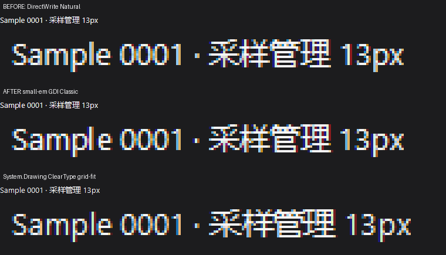
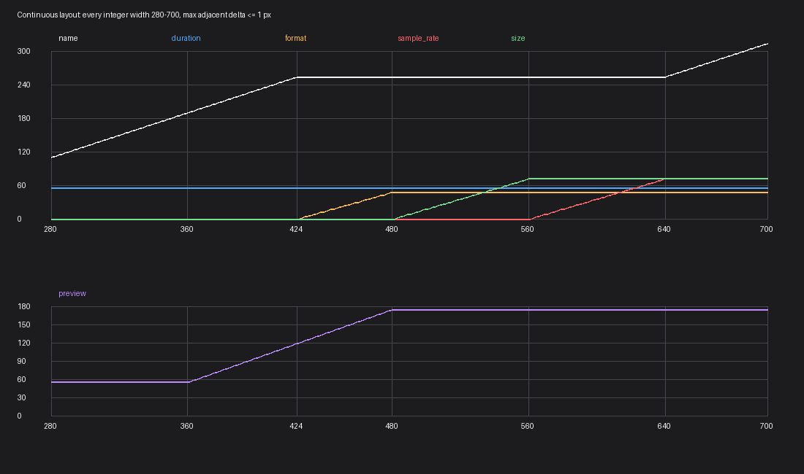
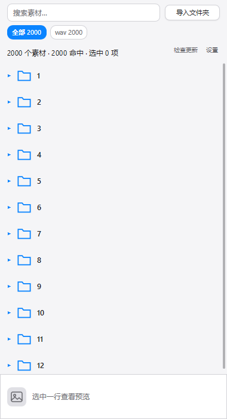

# OTTO 文字、连续布局与恢复默认大小：修复报告

日期：2026-11-03。工作树：`C:\src\otto-polish`。未提交 commit。

## 一、文字：根因、对照与剩余差距

### 对照口径

- 同一段：`Sample 0001 · 采样管理 13px`；同一字族 Segoe UI；13px / 96 DPI / 1x。
- 同一背景 `#1c1c1e`、前景 `#f5f5f7`。
- 原生基准是 **System.Drawing + ClearTypeGridFit**，不是截一张不同条件的图。
- OTTO 由 `ui.Tester` 离屏渲染，原生位图也离屏生成；全程不建可见窗口、不截桌面。

三联图（修前 Natural / 修后 GDI Classic / System.Drawing）：

机器可读数据见 [metrics.json](text-cleartype/metrics.json)。

### 根因

这台机器没有 Inter / Geist，OTTO 实际解析到的就是 **Segoe UI**；A/B 中字族、字号、gamma/contrast、RGB 覆盖与合成代码均保持不变。因此“字体回退差”与“字发灰”都不是主因。

修前 13px 走 **DirectWrite NATURAL（mode 4）**，采用分数 advance 与更多水平相位；System.Drawing 使用 ClearType grid-fit。差异主要在小字号的网格拟合、字距与边缘分布，而不是 RGB 通道仍然缺失。

### 修法

`nanoui/src/ui/dwrite.zig` 在物理 em ≤ 16px 时选择 **GDI_CLASSIC（mode 2）**，保留同一字体文件、DirectWrite 字形覆盖、RGB ClearType、gamma/contrast 与既有 D3D/CPU 合成；较大字号继续采用 DirectWrite 推荐模式。小字号因此使用整数 pen position，避免横向二次平滑。

Natural 的 Direct2D 逐像素回归仍保留 3/255 严约束；Classic 单独断言渲染模式与整数相位，不套用另一套对比度公式。

### 修后还差多少

| 指标（灰度，0–255） | 修前 Natural | 修后 GDI Classic |
| --- | ---: | ---: |
| 与 System.Drawing 的最佳平移 MAE | 5.1736 | **4.7748** |
| 相对改善 | — | **7.71%** |
| 最佳水平偏移 | -1px | **0px** |

强覆盖像素比例由 0.500 提至 0.530；覆盖总量仅由 599.519 变为 592.006（约 -1.25%），说明不是简单加黑。**仍有 4.7748/255 的差异**：System.Drawing/GDI+ 与 DirectWrite 的 advance 和边缘 enhanced-contrast 并不相同，本报告不宣称逐像素一致。

复现：`zig\text-compare.ps1`（构建步骤只写缓存，不安装额外 exe）。

## 二、布局：连续尺寸而不是硬断点

`responsive_layout.zig` 不再按 360 / 480 / 640 切换整组列：

1. 采样率连同其间距（80px slot）在 640 → 560 宽之间逐像素让位；
2. 大小（80px slot）在 560 → 480 之间让位；
3. 格式（56px slot）在 480 → 424 之间让位；
4. 名称列始终吃剩余，时长列与名称最小可读宽度不让；
5. 预览高度在 360 → 480 宽之间，从 56 连续插值到 `clamp(高/4,56,180)`。

关键点是 **slot 同时包含列宽与前置 gap**。否则列消失时会突然把 8px 间距还给名称列，仍然是一场硬跳。`row_ui.zig` 使用求解器给出的连续 gap，不再由 flex 另算一组固定 8px 间距。

默认 380×700 时预览由旧 56 连续变为 75；479 / 480 / 481 宽时分别为 174 / 175 / 176，不再 56 ↔ 175 跳变。

回归测试遍历 **280–900 的每个整数宽度**：名称、每个辅助列和预览高度的相邻变化都 ≤1px；列出现/消失也 ≤1px，且始终无重叠、无越界、名称不低于下限。200 次 resize 的求解仍远低于 16ms。

证据：[layout-continuous/series.csv](layout-continuous/series.csv) 与 [layout-continuous/layout.png](layout-continuous/layout.png)（由真实 `responsive_layout.solve` 导出）。[verification.json](layout-continuous/verification.json) 记录 421 个宽度的最大相邻变化：name/duration/format/sample_rate/size/preview = **1/0/1/1/1/1px**。

## 三、恢复默认窗口大小

设置面板新增 **“恢复默认大小（380×700）”**：

- `Panel.restoreDefaultWindowSize` 同时更新真实 client area、持久化 layout 与下一帧容器布局；
- Windows `Window.setSize` 增加 `SWP_NOACTIVATE`，不抢焦点；
- 修复关闭窗口时把外框尺寸写回 client layout 的旧问题（会把 380×700 写成 396×739），现在关闭时也记录 content size。

`zig\restore-size.ps1` 从 900×1000 启动隐藏真实 HWND，**实际点击“设置 → 恢复默认大小”**，随后再次启动并断言快照和 settings 都是 380×700。结果：**PASS**。

## 四、是否提给 nanoui 上游

**这套 OTTO 布局求解器不整套上游化。** 它硬编码素材行的缩略图、序号、名称/时长/格式/采样率/大小及 OTTO 让位阈值；nanoui 已有通用 flexbox，直接收一个素材列表求解器会违反“fork 不写 app-specific 补丁”的边界。

值得单独提炼的是：① slot 同时吸收 gap 的连续让位方法及逐像素测试；② 小字号 GDI Classic 策略；③ `setSize` 的 `SWP_NOACTIVATE`。① 等出现第二个真实调用方后再形成通用 gap-aware track primitive，②③ 本身就是通用平台修复，可以独立提上游。

## 五、最终验收

- `health.ps1 -Quick`：**10 PASS / 1 SKIP**；core **90/90**、ports **192/192**、app **409/409**，55 项形态审计、产物纯净性、13/13 provider、29/29 透明度、zip+setup 签名全过（唯一 SKIP 是未请求的 `-Fresh`）。
- nanoui：304 passed / 11 skipped（总汇总 309/320），另有工具测试 5/5。
- 恢复默认大小：真实按钮点击 + 重启，PASS。
- `membudget.ps1 -Release -NoBuild`：**PASS**；WS **43.00/50 MiB**，L2+preview **48/48 MiB**，PCM **2.08/6 MiB**，真实隐藏 HWND PCM 峰值 **38.28/50 MiB**。
- `scroll.ps1 -Release -NoBuild`：**GDI 62.50 fps PASS**；D3D no-vsync 同为 **62.50 fps PASS**，300 帧工作耗时无超预算，窗口从未成为前台。
- `browse.ps1`：**49 PASS**，浏览模式 1 万行滚动同样 **62.50 fps**。
- nanoui `zig build lines`：**362 files, all within 600 lines**。
- 未改 `zig/core`；未新增 C / `@cImport`；未 commit；验收均走离屏、隐藏或无激活窗口路径。
