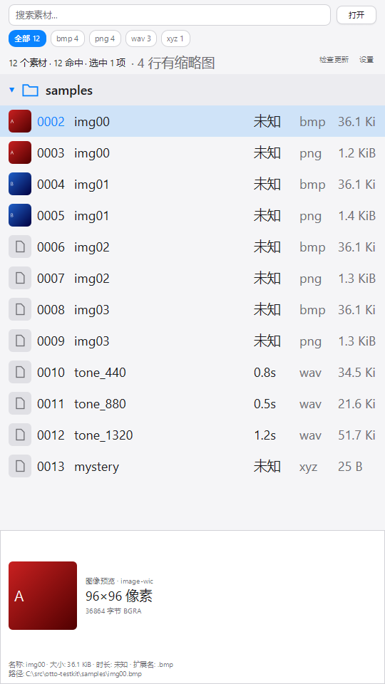
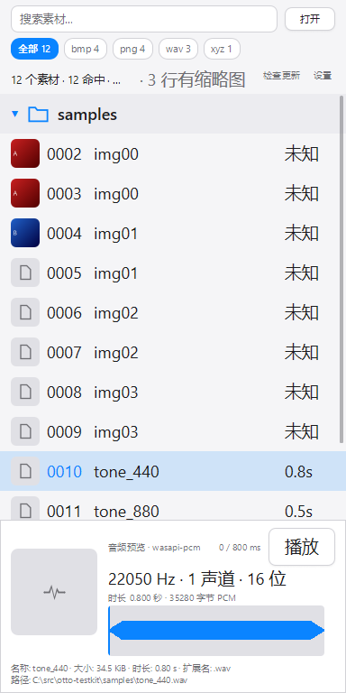

# OTTO 字号、默认窗口与预览下限：调整报告

日期：2026-11-04。工作树：`C:\src\otto-uipolish`。**未提交 commit。**

## 一、字号新值

本轮指定的产品 UI 字号全部再提升一级，没有因布局问题保留 13/15 的例外：

- **13 → 16**：打开菜单的“选择文件 / 选择文件夹”、搜索无结果标题等；布局约束中的 `font_size` 同步为 16。
- **15 → 18**：设置标题、按钮、标签与输入框；样本行、文件夹行、列表状态；图像 / 文本 / 音频等预览主文字和播放按钮；浏览及空状态同级文字。
- 既有辅助说明小字（9–12px）不盲目放大；`text_compare.zig` 的 13px 光学基准探针不是产品 UI，保持原样。
- 为容纳 18px 的四位序号，序号槽由 34 增至 44px；列表行高仍为 44px，名称及辅助列继续由容器求解器分配。
- 点击目标保持至少 24px；设置滑块的实际点击高度也由 22 补到 **24px**。

默认窗口和最小窗口的设置面板、样本列表、图像预览、音频预览均已出图检查，未见重叠或越界。

## 二、默认窗口与恢复默认大小

**默认 client area 为竖屏 `540×960`**，不是横屏。

默认值已统一到：

1. `responsive_layout.default_window_width / height`；
2. settings v2 的 `Layout` 默认值及 JSON 缺字段反序列化；
3. 布局缓存的非有限尺寸回退值；
4. 设置按钮“恢复默认大小（540×960）”及其实际 `setSize`、持久化路径。

已有用户显式保存的更大尺寸继续保留；小于新下限的尺寸会夹到下限。不会为了改默认值而重置整个设置文件。

真实隐藏 HWND 验证三条路径均为 **PASS**：

- 全新启动、没有 settings：`540×960`；
- 从 `900×1000` 实际点击“设置 → 恢复默认大小”：回到 `540×960`；
- 再次启动读取保存值：仍为 `540×960`。

证据：[restore-default-size/probe.log](restore-default-size/probe.log)、[全新默认截图](restore-default-size/fresh-default.png)、[恢复后截图](restore-default-size/restored-click-final.png)。

## 三、预览不再突变：根本不允许缩到不可用尺寸

已删除“太小隐藏”和 56px 紧凑预览分支。现在只有**完整预览**，没有“窄到没用的条”。

### 最小尺寸依据

按最占空间的**音频分支**定量，而不是只看图像分支：

- **宽度**：240px 波形 + 96px 图位 + 12px 图位间距 + 24px 横向 padding + 2px 边框 ≈ **374px**，取 **384px**。
- **预览高度**：18px 播放按钮 / 正文、时长行、56px 波形和内部间距约 136px；两行事实、预览区间距、上下 padding 与边框约 48px，共约 184px，留余量取 **192px**。
- 预览公式为 `clamp(192, 窗口高 / 4, 216)`，所以最小窗口高度为 `192 × 4 = 768px`。

因此**最小 client area 为 `384×768`**。默认 `540×960` 时，预览为 **216px**；最小窗口时仍有 **192px** 完整预览。

### 用户拖到下限时会看到什么

Windows 在 `WM_GETMINMAXINFO.ptMinTrackSize` 中夹住尺寸，继续往下 / 往内拖也不会再缩小。nanoui 现在用窗口实际 style / exstyle 调 `AdjustWindowRectEx`，把 client-area 下限换算成外框下限，避免标题栏和边框吃掉内容空间。

到达 `384×768` 后：尺寸停止变小，播放键、240px 波形、18px 格式行、96px 图位和两行事实仍正常显示；不隐藏、不占位、不退化成细条。

### 连续尺寸出图

`zig\layout-sizes.ps1` 以真实隐藏 HWND 跑了 9 个从大到小的尺寸，包含低于下限的请求：

- `540×960 → 216px`；
- `540×800 → 200px`；
- `540×768 → 192px`；
- `540×720` 被夹为 `540×768`；
- `360×600` 被夹为 `384×768`。

机器可读结果：[ui-size-preview/verification.json](ui-size-preview/verification.json)。

默认窗口的列表与图像预览：

最小窗口的音频预览（播放、波形、事实均完整）：

## 四、用户在 540×960 默认窗口下看到什么

- 竖屏更大的搜索、后缀 chips、状态区和列表区域；主列表文字为 18px，行高仍 44px，增加的纵向空间用于更多行，而不是把行拉伸。
- 540px 宽时显示名称、时长、格式和大小列；采样率列仍按现有连续求解器在更宽容器中加入，长文本只在各自格内截断，不挤相邻列。
- 底部是 216px 完整预览：图像有 96px 图位、类型 / 尺寸与文件事实；音频有播放键、格式、时长、240px 波形和文件事实。
- 在本次 12 个样本的测试库中，展开文件夹后 12 条样本可同屏看到，并仍保留完整底部预览；实际可见行数随 chips、浏览状态条等现有内容自然变化。

## 五、最终验收

| 项目 | 结果 |
| --- | --- |
| `health.ps1 -Quick` | **10 PASS / 1 SKIP**（仅未请求的 `-Fresh` 跳过） |
| core / ports / app | **90/90、192/192、409/409** |
| 形态审计 | **14/14 PASS**；dev / portable / installed |
| provider / 透明度 | **13/13 两轮；29/29** |
| 签名 | 0.61.0 portable zip + setup，**PASS** |
| `membudget.ps1 -Release -NoBuild` | **PASS**；WS **46.23/50 MiB**，L2+preview **48/48 MiB**，PCM **2.08/6 MiB**，真实隐藏 HWND 音频峰值 **39.59/50 MiB** |
| `scroll.ps1 -Release -NoBuild` | 540×960 下 GDI **62.50 fps PASS**；D3D no-vsync **62.50 fps PASS**；两者 300 帧均为 0 个超工时预算帧 |
| `browse.ps1` | **49 PASS**；浏览模式 1 万行滚动 **62.50 fps** |
| 恢复默认大小 | 全新默认 / 真实按钮点击 / 重启，均 **540×960 PASS** |
| nanoui | **314 PASS / 11 SKIP**；`zig build lines`：**365 files, all within 600 lines** |

所有 UI 验收均走离屏、隐藏或屏外无激活窗口；没有弹窗或抢焦点。未改 `zig/core`，未新增 C / `@cImport`，未提交 commit。安装包只构建和签名，未运行安装。
